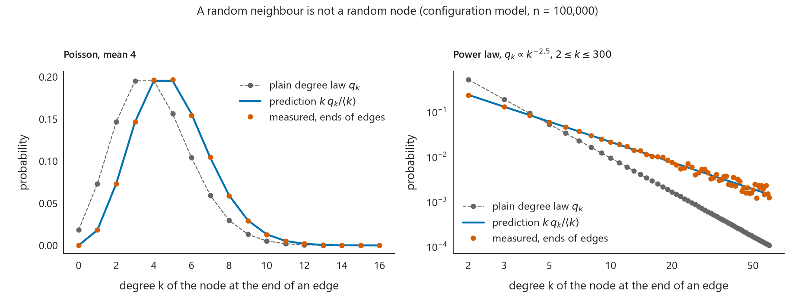
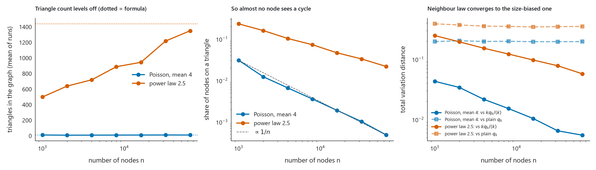

# Why your neighbours have more neighbours: size-biased degrees in the configuration model
> In a 100,000-node configuration model with Poisson(4) degrees, a node reached along a random edge has mean degree 4.9931 against 3.9987 for a random node, and its degree law sits 0.0039 from the predicted $`k\,q_k/\langle k\rangle`$ in total variation distance (0.1952 from the plain degree law $`q_k`$).



## The idea
Pick a node at random and you get the degree law $`q_k`$. Pick an edge at random and walk to one end, and you get a different law, because a node with $`k`$ edges has $`k`$ chances to be the one you land on. That bias is the friendship paradox, and it is the first thing you need before doing any calculation on a random network. The second half of the project checks the assumption that makes those calculations tractable: in the configuration model the neighbourhood of a node is a tree with probability going to 1 as the network grows, so short cycles such as triangles vanish.

## Results
| Quantity | Poisson, mean 4 | Power law, exponent 2.5 |
|---|---|---|
| Mean degree, formula | 4.0 | 4.3854 |
| Mean degree, measured | 3.9987 | 4.4009 |
| Mean neighbour degree $`\langle k^2\rangle/\langle k\rangle`$, formula | 5.0 | 21.516 |
| Mean neighbour degree, measured | 4.9931 | 21.7533 |
| Distance from plain $`q_k`$ | 0.1952 | 0.3514 |
| Distance from $`k\,q_k/\langle k\rangle`$ | 0.0039 | 0.0487 |
| Share of nodes with lower degree than their neighbours' average | 0.6521 | 0.8928 |
| Triangles at $`n`$ = 64000, measured | 10.375 | 1350.0 |
| Triangles, large-$`n`$ formula | 10.667 | 1439.224 |
| Share of nodes on a triangle at $`n`$ = 64000 | 0.000486 | 0.021781 |

The first six rows use $`n`$ = 100,000 and one seed. The triangle rows are means over 16 graphs per size. For the Poisson law the neighbour law is essentially the size-biased law, and 65% of nodes have a lower degree than their neighbours' average. The power law has the same effect at a much larger scale (89% of nodes, neighbour mean 21.7533 against a node mean of 4.4009), but its tail makes the match slower: the distance is still 0.0487 at 100,000 nodes.



The Poisson triangle count sits around 10 at every size from 1,000 to 64,000 nodes, which is the point: the count stays fixed while $`n`$ grows, so the share of nodes on a triangle falls like $`1/n`$ (0.03075 at $`n`$ = 1000, 0.000486 at $`n`$ = 64000). The power-law count is still climbing toward its formula, from 499.438 at 1,000 nodes to 1350.0 at 64,000.

## How it works
1. Draw $`n`$ degrees independently from $`q_k`$, redrawing single nodes until the degree sum is even.
2. Give node $`i`$ exactly $`k_i`$ stubs, shuffle all stubs, and pair them off two at a time. Self-loops and multi-edges are kept.
3. Follow an edge to one end. About $`n q_k`$ nodes have degree $`k`$ and each holds $`k`$ of the $`n\langle k\rangle`$ stubs, so the node you land on has degree $`k`$ with probability

```math
\tilde q_k = \frac{k\,q_k}{\langle k\rangle}
```

4. The mean of that law is never smaller than the mean of $`q_k`$:

```math
\sum_k k\,\tilde q_k = \frac{\langle k^2\rangle}{\langle k\rangle} \ge \langle k\rangle
```

   Dropping the edge you arrived by leaves $`r_k = (k+1)\,q_{k+1}/\langle k\rangle`$ other edges. For a Poisson law this equals $`q_k`$ exactly.
5. For tree-likeness, nodes $`i`$ and $`j`$ are joined with probability about $`k_i k_j/(n\langle k\rangle)`$, which shrinks as $`n`$ grows when $`\langle k\rangle`$ is fixed. Summing over triples gives an expected triangle count that does not depend on $`n`$:

```math
\mathbb{E}[\#\text{triangles}] \to \frac{(\langle k^2\rangle - \langle k\rangle)^3}{6\,\langle k\rangle^3}
```

   Triangles are counted on the simplified graph as the sum of $`A \circ A^2`$ over all entries, divided by 6.

## Run it
```bash
pip install -r requirements.txt
python src/main.py          # writes results/
python -m unittest -v       # the checks
```

## What the tests check
- Every pmf sums to 1, including $`\tilde q_k`$ and $`r_k`$.
- The mean of $`\tilde q_k`$ equals $`\langle k^2\rangle/\langle k\rangle`$, and a constant-degree law gives a neighbour mean equal to the degree.
- The excess law of a Poisson distribution is the same Poisson, to 1e-12.
- Stub pairing reproduces the degree sequence exactly and rejects an odd degree sum.
- Mean neighbour degree agrees with `networkx.average_neighbor_degree` on a random graph.
- Triangle counts match `networkx.triangles` on a random graph, a lone triangle gives 1, and a balanced tree gives 0.
- On 40,000 sampled nodes the neighbour law is within 0.02 of $`\tilde q_k`$ and more than 0.1 from $`q_k`$.

## Layout
```text
.
├── README.md
├── src/
│   ├── neighbor_degree.py   # distributions, configuration model, triangle counts
│   └── main.py              # experiments, figures, results.json
├── tests/
│   ├── __init__.py
│   └── test_neighbor_degree.py
└── results/
    ├── neighbour_degree.png
    ├── scaling.png
    └── results.json
```

## Limits
- The power law is truncated at degree 300, so its second moment is finite. An untruncated exponent of 2.5 has infinite variance, and the formulas here would not apply.
- Only triangles are counted. That is the shortest cycle, not a check that every radius-$`d`$ neighbourhood is a tree.
- This is one model of a network. Real networks are usually more clustered than the configuration model predicts.

*From Math168 at UCLA, 2026-11-06.*
